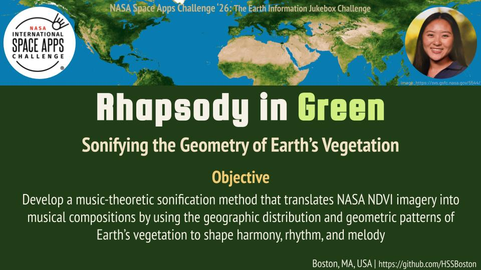

  

This project ... It was developed at the NASA Space Apps Challenge 2026. 

NASA Space Apps Challenge is an annual hackathon event (or an innovation incubation and civic engagement program) where NASA puts out about 20 challenges for participants around the world to develop innovative solutions.

## Short Project Summary
