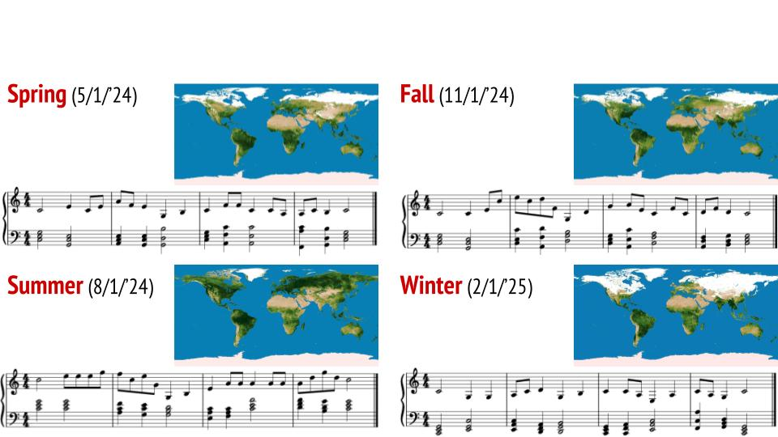

## Sonification Examples: A Seasonal Suite in Green 

The proposed sonification method was applied to four NASA NDVI images representing different seasons: 

- Spring (May 1, 2024)
- Summer (August 1, 2024)
- Fall (November 1, 2024)
- Winter (February 1, 2025)

Each image was translated into a four-measure musical composition, with harmony, rhythm, and melody shaped by the geographic distribution and geometric patterns of vegetation greenness. 

  

